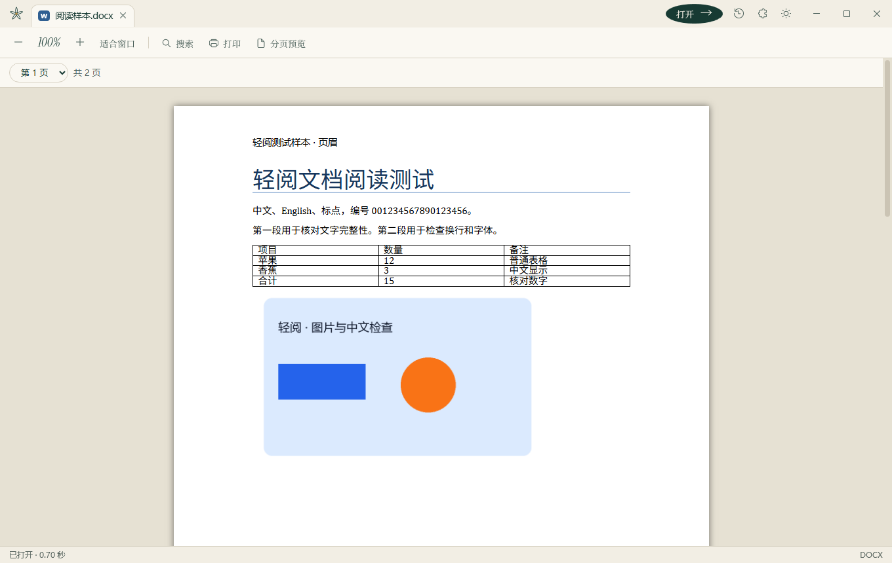
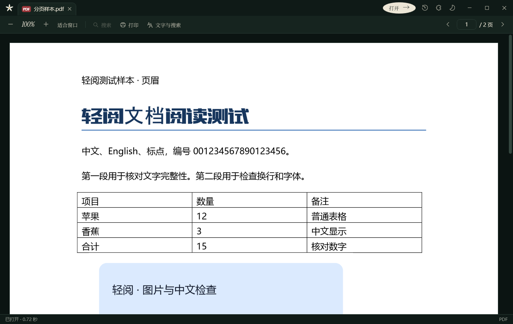

<div align="center">

<picture>
  <source media="(prefers-color-scheme: dark)" srcset="docs/images/home-dark.png">
  
</picture>

# 塞西莉亚的图书馆

*The Library of Cecilia*

一个安静、轻巧的 Windows 本地文档阅读器。<br>
文字、表格、演示、PDF 与图片，双击即读；文档只在这台电脑上处理。

[](https://github.com/1606835963aa/cecilia-library/releases)
[](https://github.com/1606835963aa/cecilia-library/actions/workflows/checks.yml)
[](LICENSE)


[下载安装](#下载安装) · [支持的格式](#支持的格式) · [使用方法](#使用方法) · [从源码构建](#从源码构建) · [参与贡献](CONTRIBUTING.md)

</div>

---

## 为什么做它

打开一份文档，不该先等一个庞大的办公套件启动、登录、弹广告。塞西莉亚的图书馆只做一件事：**把文档准确、安静地显示出来**。

- **轻巧**：安装包约 7 MB，主程序不内置任何大型引擎。
- **按需安装**：Word、表格、办公兼容三个组件，第一次用到时才提示下载，下载后离线可用。
- **本地处理**：不上传、不联网读取文档，组件下载会核对大小和 SHA-256 指纹。
- **格式齐全**：目标覆盖 47 种常见办公后缀，其中 46 种已通过样本显示验证，包括 WPS 原生的 `.wps` `.et` `.dps` 等。
- **读得舒服**：多标签阅读、搜索、缩放、打印，记住阅读位置；日间与夜间两套配色。
- **少量编辑**：TXT 和 CSV 可以直接修改并另存，保存时保护原文件不被意外覆盖。

<table>
  <tr>
    <td width="50%"></td>
    <td width="50%"></td>
  </tr>
  <tr>
    <td align="center"><sub>Word 文档按页显示</sub></td>
    <td align="center"><sub>夜间模式下阅读 PDF</sub></td>
  </tr>
</table>

## 下载安装

1. 到 [Releases 发布页](https://github.com/1606835963aa/cecilia-library/releases) 下载 `CeciliaLibrary-Setup-版本号-x64.exe`。
2. 双击安装。不需要管理员权限，默认装在当前用户的程序目录。
3. 如果电脑还没有 **.NET 10 桌面运行时**，安装程序会从微软官方下载（约 57 MB），这一步 Windows 会请求一次管理员确认。

**运行要求**：Windows 10（2004 及以上）或 Windows 11，64 位。Word、表格和网页文档的显示依赖 Microsoft Edge WebView2 运行时，Windows 11 已自带。

> [!NOTE]
> 安装包暂未进行代码签名，Windows 可能显示“Windows 已保护你的电脑”。点击 **更多信息 → 仍要运行** 即可继续。

安装时勾选“登记到打开方式”后，可以右键文件 → **打开方式** 选择塞西莉亚的图书馆，或在 Windows 设置的“默认应用”中设为默认。卸载时会询问是否一并删除设置和已下载的组件。

## 支持的格式

| 类型 | 后缀 | 由谁显示 |
|---|---|---|
| 文字 | `.docx` `.docm` `.dotx` `.dotm` | Word 组件 |
| | `.doc` `.dot` `.wps` `.wpt` `.odt` | 办公兼容组件 |
| | `.txt` `.rtf` `.xml` `.htm` `.html` `.mht` `.mhtml` | 主程序 |
| 表格 | `.xlsx` `.xlsm` `.xltx` `.xltm` `.xls` `.xlt` `.et` `.ett` `.csv` `.prn` `.dif` `.dbf` `.xla` `.xlam` | 表格组件 |
| 演示 | `.pptx` `.pptm` `.potx` `.potm` `.ppsx` `.ppsm` `.ppt` `.pot` `.pps` `.dps` `.dpt` | 办公兼容组件 |
| PDF | `.pdf` | 主程序（Windows 自带 PDF 引擎） |
| 图片 | `.jpg` `.png` `.bmp` `.tif` | 主程序 |

软件依据文件内容识别格式，改错后缀的文件也能正确处理或给出提示。宏、加载项代码和外部链接一律不执行。`.ts` 出现在 WPS 宣传的格式中，但还没找到确定的格式定义，暂未支持。逐项验证记录见 [格式支持清单](docs/格式支持清单.md)。

### 组件

| 组件 | 下载 | 安装后 | 用途 |
|---|---|---|---|
| Word 快速预览 | 0.2 MB | 0.2 MB | DOCX 系列，基于 [docx-preview](https://github.com/VolodymyrBaydalka/docxjs) |
| 表格数据视图 | 0.9 MB | 0.9 MB | 各类表格，基于 [SheetJS](https://sheetjs.com/) |
| 办公兼容与分页预览 | 356 MB | 约 1.5 GB | 旧版与 WPS 原生格式、演示文稿、分页预览，基于 [LibreOffice](https://www.libreoffice.org/) |

组件在“组件”页面里可以随时安装、查看占用或移除。

## 使用方法

- **打开文档**：双击文件、拖进窗口，或按 `Ctrl+O`。多个文件以标签排列，鼠标中键点标签可关闭。
- **PDF**：默认按页面阅读；需要搜索或复制文字时，点工具栏的“文字与搜索”。
- **表格**：顶部切换工作表，按组翻行翻列；搜索会跨工作表查找。WPS 表格可切换“分页预览”查看打印布局。
- **外观**：右上角按钮在跟随系统、浅色、深色之间切换，文档纸张始终保持白底。

<details>
<summary><b>快捷键</b></summary>

| 操作 | 按键 |
|---|---|
| 打开文件 | `Ctrl+O` |
| 搜索 / 下一个 / 上一个 | `Ctrl+F` / `Enter` 或 `F3` / `Shift+Enter` 或 `Shift+F3` |
| 关闭搜索 | `Esc` |
| 打印 | `Ctrl+P` |
| 另存为（编辑时） | `Ctrl+S` |
| 关闭当前文件 / 切换标签 | `Ctrl+W` / `Ctrl+Tab` |
| 缩放 / 恢复 100% | `Ctrl+滚轮` 或 `Ctrl + -` / `Ctrl+0` |
| PDF 翻页 | `PageUp` / `PageDown` |

</details>

更多说明见 [使用说明](docs/使用说明.md)。

## 已知限制

当前为 0.x 预览版，下面这些还没完成：

- Word / Excel 原格式编辑、PDF 批注尚未提供；编辑只支持 TXT 和 CSV。
- 带密码的文档、复杂图表与嵌入对象、多版本 WPS 原生文件的覆盖还在扩充。
- 拖放、系统打开对话框和打印对话框只做过程序内部检查，没有人工实际操作验收。
- 安装程序自动补装 .NET 运行时的流程，尚未在全新电脑上验证。

## 从源码构建

需要 Windows 10/11 x64、PowerShell、[Node.js](https://nodejs.org/)（仅用于编译阅读页面的 TypeScript）和 `curl`。在项目根目录执行：

```powershell
.\scripts\prepare.ps1              # 下载并核对 .NET SDK、Inno Setup 与开发依赖
.\scripts\build.ps1 -Installer     # 编译并生成 dist\installer 下的安装包
```

开发时可直接双击 `启动塞西莉亚的图书馆.cmd` 运行 `dist\LightReader` 中的程序，设置与缓存保存在项目的 `.local-data`。检查、测量和样本生成的完整说明见 [构建说明](docs/构建说明.md)。

<details>
<summary><b>项目结构</b></summary>

| 目录 | 内容 |
|---|---|
| `src/LightReader.App` | WPF 主程序：窗口、标签、PDF 页面阅读、组件页 |
| `src/LightReader.Core` | 格式识别、文本编辑与保存、组件下载安装、办公转换 |
| `src/LightReader.PdfWorker` | 独立的 PDF 绘制进程，阅读时启动，回首页即退出 |
| `src/preview` | WebView2 中运行的阅读页面（TypeScript） |
| `installer` | Inno Setup 安装包脚本 |
| `data` | 格式目标、组件清单、样本清单与依赖版本 |
| `tests` | 核心检查与合成测试样本 |
| `docs` | 产品方案、开发进度、验证记录 |
| `reports` | 各轮检查与测量的原始结果 |

</details>

## 参与贡献

欢迎提交问题和改进。开始之前请读一下 [贡献指南](CONTRIBUTING.md)；发现安全问题请按 [安全说明](SECURITY.md) 私下报告。

## 许可证

本项目以 [GNU Affero 通用公共许可证 第 3 版（AGPL-3.0）](LICENSE) 发布。你可以自由使用、修改和分发；分发修改后的版本时，需要以同样的许可证公开源代码。

界面字体、阅读组件等第三方内容保留各自的许可证，见 [licenses](licenses) 目录与 [依赖清单](docs/依赖清单.md)。
